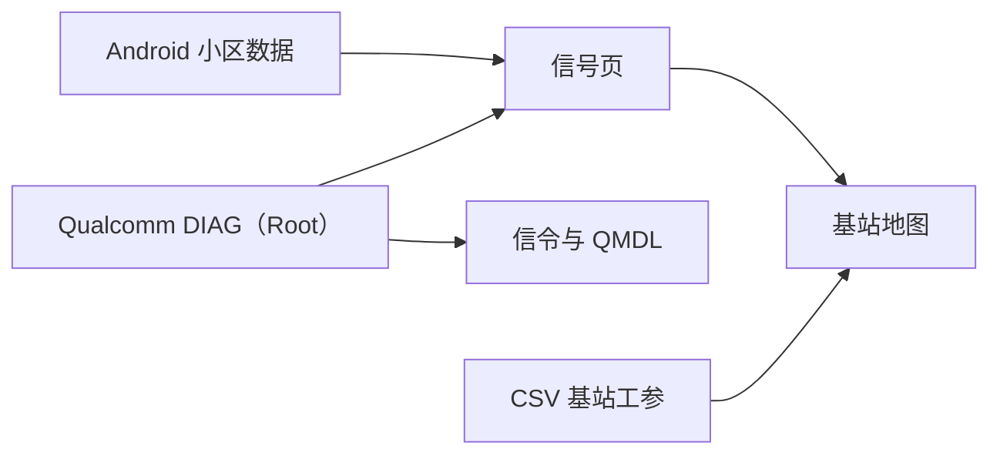

<p align="center">
  
</p>

<h1 align="center">无线无忧 · WirelessSignalMeter</h1>

<p align="center">Android LTE / 5G NR 信号测量、基带信令与基站地图</p>

<p align="center">
  
  
  <a href="LICENSE"></a>
</p>

> **上游来源**：本仓库基于 [christianrowlands/android-network-survey](https://github.com/christianrowlands/android-network-survey)（[Apache License 2.0](LICENSE)）派生，并在其基础上新增了 5G NR DIAG 信令、锁频/锁小区、QMDL 录制与基站地图等功能。

<p align="center">
  <a href="#快速开始">快速开始</a> ·
  <a href="#从源码构建">源码构建</a> ·
  <a href="CHANGELOG.md">更新记录</a> ·
  <a href="https://github.com/niceboat0/WirelessSignalMeter/issues">问题反馈</a>
</p>

## 能做什么

| 功能 | 界面与数据 |
| --- | --- |
| **服务小区与邻区** | 查看服务小区的 RSRP、RSRQ、SINR、注册与广播 PLMN、频点、双工模式和信号趋势。邻区按 RSRP 排序，5G 带宽随可用数据显示。 |
| **信令与 QMDL** | 在支持 Root DIAG 的设备上查看 RRC / NAS 等信令、部分物理层调度与分层吞吐率，录制和导出原始基带包。 |
| **工参与基站地图** | 导入 CSV、按基站 ID 搜索。蓝线连接服务小区，橙线连接匹配到工参的实测邻区。 |
| **网络工具** | 查看 Wi-Fi 信号和 GNSS 卫星信息，或使用服务器测速。 |



## 快速开始

当前源码支持 Android 11 及以上的 `arm64-v8a` 设备；已发布旧版的最低系统要求以其安装包为准。普通信号页读取 Android 小区数据。DIAG 信令和 QMDL 需要 Root 授权以及可用的 Qualcomm DIAG 接口，字段覆盖随设备和基带版本变化。

1. **信号测量** · 打开「信号」，按需授予系统权限，查看当前小区、邻区和信号趋势。
2. **地图匹配** · 在「设置 → 基站工参」导入 CSV 并检查字段映射，然后打开「工具 → 基站地图」。
3. **记录信令** · 在「工具 → 信令」的筛选菜单开始或停止录制 QMDL。需要保留上一份录制时请先导出。
4. **反馈问题** · 从「设置 → 导出诊断日志」保存 JSONL，并参阅[数据与隐私说明](privacy_policy.md)。

## 从源码构建

安装 Android Studio、Android SDK Platform 37 和 NDK `27.3.13750724`。将 Gradle JDK 配置为 Android Studio 自带的 JBR。模块为 `networksurvey`，当前构建变体为 `cdr`，发布包名为 `com.wireless.signalmeter.new`。

```sh
./gradlew :networksurvey:assembleCdrRelease
./gradlew :networksurvey:testCdrDebugUnitTest
```

Windows PowerShell 下将 `./gradlew` 替换为 `.\gradlew.bat`。APK 输出到 `networksurvey/build/outputs/apk/cdr/release/`。安装前可运行 `apksigner verify --print-certs <APK文件>` 检查签名。覆盖安装要求包名和签名与已安装版本一致。当前源码的 Release 配置使用构建环境的调试签名。

设备回归检查见[测试指南](docs/TESTING.md)，版本变更见[更新记录](CHANGELOG.md)。

## 文档

| 文档 | 内容 |
| --- | --- |
| [更新记录](CHANGELOG.md) | 无线无忧版本变更及上游历史 |
| [测试指南](docs/TESTING.md) | 信号、信令、基站地图和导出的回归步骤 |
| [数据与隐私说明](privacy_policy.md) | 日志、数据传输与分享 |
| [安全报告说明](SECURITY.md) | 安全问题的报告渠道 |

<details>
<summary>调查记录与集成 · gRPC、MQTT 和 Intent API</summary>

以下集成沿用上游 Network Survey 的协议说明。相关功能与配置以当前构建为准。

### gRPC Survey Record Streaming

The Network Survey app supports streaming GSM, CDMA, UMTS, LTE, and 802.11 survey records to a gRPC
server. More specifically,
the [Network Survey Messaging](https://github.com/christianrowlands/network-survey-messaging)
library can be used to stand up a gRPC server. From there it is up to the implementation to handle
the incoming survey messages.

If you want to see how to use the generated Go code to create a gRPC server, check out the code at
https://github.com/christianrowlands/ns-messaging-go-grpc-server

The server does not do anything useful, but serves as an example of how one might be created in
GoLang.

### MQTT Broker Survey Record Streaming

Currently, GSM, CDMA, UMTS, LTE, NR, 802.11, Bluetooth and GNSS survey records are sent to a
connected MQTT broker. They are published on the following MQTT Topics:

* gsm_message
* cdma_message
* umts_message
* lte_message
* nr_message
* 80211_beacon_message
* bluetooth_message
* gnss_message

There is also a DeviceStatus and a PhoneState message that is published on
the `device_status_message` topic.

The MQTT Broker connection supports both plain text and TLS/SSL connections.

The survey messages are sent in JSON format following the protobuf definitions from
the [Network Survey Messaging](https://github.com/christianrowlands/network-survey-messaging)
library. [The API documentation is published to a web page here](https://messaging.networksurvey.app/)
.

QR Code for MQTT Broker connection setting needs to provide a JSON string with the following fields.

The `mqtt_client` field is optional and will default to the App's auto-generated value.

The `mqtt_topic_prefix` field is used to prefix the MQTT topics that the survey records are
published
to. The default topics are listed above (e.g. `lte_message`), but if you want to add a custom
prefix,
you can use the `mqtt_topic_prefix` field to change the topic to something like
`my/custom/topic/lte_message` by setting the value to `"mqtt_topic_prefix": "my/custom/topic/"`
(notice the trailing slash).

```json
{
  "mqtt_host": "cloud.mymqttserver.com",
  "mqtt_port": 8883,
  "mqtt_tls": true,
  "mqtt_client": "aclient",
  "mqtt_username": "auser",
  "mqtt_password": "apassword",
  "mqtt_topic_prefix": "my/custom/topic/path/",
  "mqtt_qos": 1,
  "cellular_stream_enabled": true,
  "phone_state_stream_enabled": true,
  "wifi_stream_enabled": true,
  "bluetooth_stream_enabled": true,
  "gnss_stream_enabled": true,
  "device_status_stream_enabled": true
}
```

### Intent API

The Network Survey app supports an Intent API that allows other apps to start and stop a survey. The
Intent API is documented on the [Intent API website](https://www.networksurvey.app/intent-api).

</details>

## 反馈与许可

一般问题请通过本仓库的 [GitHub Issues](https://github.com/niceboat0/WirelessSignalMeter/issues) 提交。安全问题请参阅[安全报告说明](SECURITY.md)。

本仓库沿用 [Apache License 2.0](LICENSE)。感谢上游 [Network Survey](https://github.com/christianrowlands/android-network-survey) 的维护者和贡献者，以及 [GPSTest](https://github.com/barbeau/gpstest) 与 [Tower Collector](https://github.com/zamojski/TowerCollector) 项目提供的相关组件和实现参考。
